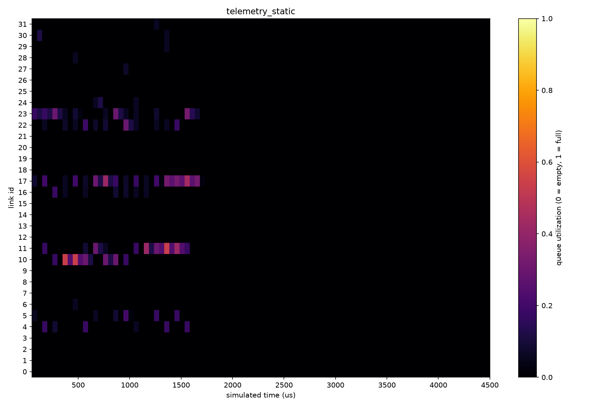
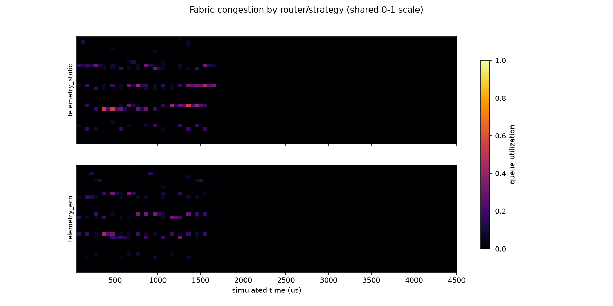
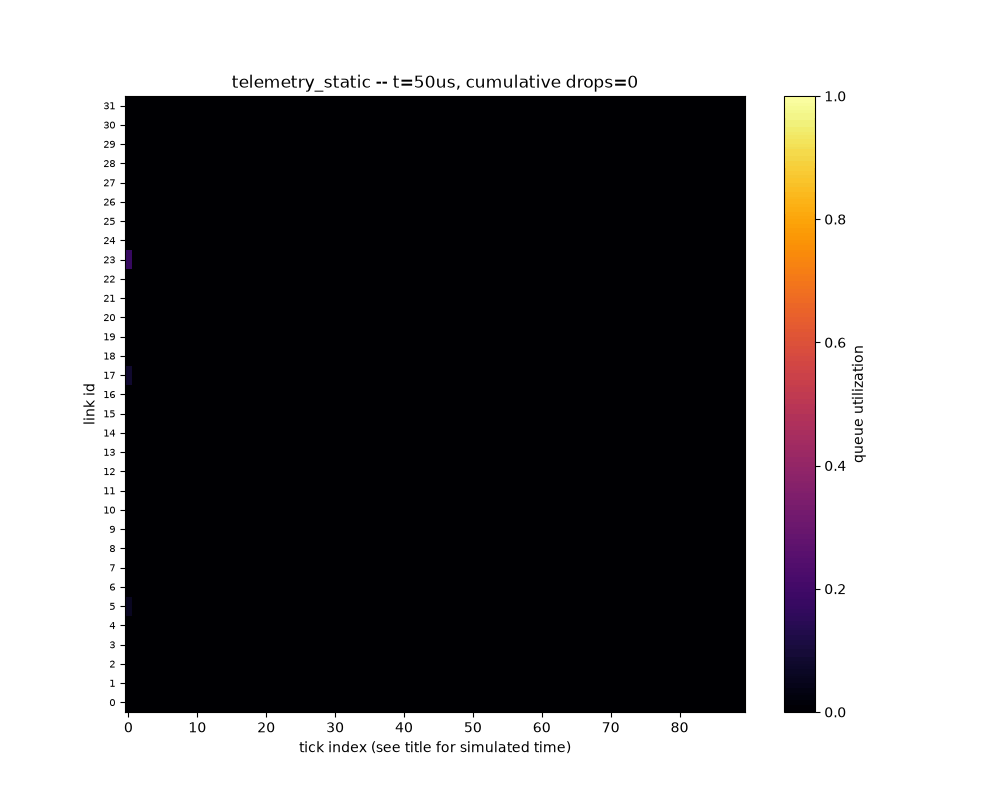
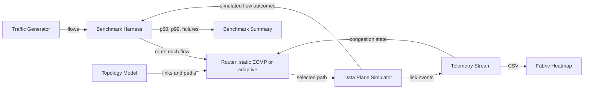

# GPU Fabric Congestion Simulator & Router

A discrete-event C++ simulator of a multi-hop GPU training fabric (Clos /
fat-tree topology) that detects congestion in simulated time and re-routes
traffic. Adaptive routing is benchmarked against static ECMP using measured
flow completion time.

## Simulation snapshots

These heatmaps are generated from the simulator's telemetry output and show
link utilization over simulated time for the default all-reduce traffic
pattern. Red `x` marks indicate packet drops.







## Design overview

- **Simulation model: discrete-event, not wall-clock real-time.**
  A single `EventQueue` (min-heap keyed on simulated time) drives everything.
  The simulator does not use real sockets or wall-clock delays. Given the
  same configuration, executable, and seed, a run is deterministic.

- **Congestion detection: strategy pattern, three interchangeable signals.**
  `CongestionStrategy` is the interface. Concrete strategies:
  - `QueueDepthStrategy` — trigger when a link's queue occupancy crosses a
    threshold (simplest, closest to real switch behavior without ECN).
  - `ECNStrategy` — trigger on ECN-style marking probability that rises with
    queue occupancy (RED/ECN-like), giving earlier, softer signals.
  - `DropRateStrategy` — trigger on a rolling window's packet drop rate
    (lagging signal, catches sustained congestion queue-depth/ECN miss).
  The `AdaptiveRouter` holds a `std::unique_ptr<CongestionStrategy>` and is
  fully agnostic to which one is plugged in — swapping strategies is a
  one-line change, and all three can be benchmarked against each other in
  addition to against static ECMP.

- **Incast handling is its own component, not folded into per-link
  congestion.** Per-link queue/ECN/drop signals see a link get busy; they
  don't see *why*. `IncastDetector` watches each destination node's inbound
  flow arrivals in a sliding time window and flags many-to-one bursts (N
  senders converging on one receiver within `window_us`) as a distinct
  event, so the router can react to "this is incast" differently from "this
  link is generically hot" (e.g. spread across more paths preemptively
  rather than waiting for the queue to fill).

## Layout

```
include/            public headers, one subfolder per module
  sim/               discrete-event core: Event, EventQueue, Clock, Simulator
  topology/          Clos/fat-tree topology generator
  traffic/           all-reduce and many-to-one traffic patterns
  router/            CongestionStrategy + implementations, StaticECMPRouter,
                     AdaptiveRouter
  incast/            IncastDetector (many-to-one burst detection)
  telemetry/         per-link stats stream (queue depth, drops, utilization)
  bench/             benchmark harness (p50/p99 flow completion time)
src/                 .cpp implementations mirroring include/
tools/viz/           Python + matplotlib CSV heatmap visualization
tests/               lightweight unit tests (no external framework)
```

## Architecture



## Build

Requirements: CMake 3.16 or newer and a C++20 compiler.

```
cmake -S . -B build
cmake --build build -j
ctest --test-dir build --output-on-failure
./build/gpu_fabric_sim --pods 4 --seed 1234 --strategy queue_depth
```

Run `./build/gpu_fabric_sim --help` for the full list of flags (topology size,
traffic shape, strategy selection, telemetry output).
See [RESULTS.md](./RESULTS.md) for reproducible benchmark examples and
interpretation.

Use `--seed-sweep N` to run each selected router over N consecutive seeds,
starting at `--seed`, and report the mean and population standard deviation
for p50, p99, and failed-flow count:

```
./build/gpu_fabric_sim --strategy all --seed-sweep 10
```

To stress buffers, `--queue-capacity-bytes N` sets the queue capacity on all
link tiers (default 8 MiB). Compare capacities across seed sweeps and inspect
failed-flow counts as well as latency; very small buffers can make every flow
fail rather than reveal a useful routing improvement.

To exercise incast detection and the adaptive router's round-robin
diversification, run the many-to-one pattern. Each chunk has all GPUs except
the receiver send to that same receiver in a short burst:

```
./build/gpu_fabric_sim --traffic many_to_one --message-bytes 1048576 --chunks 4 --strategy all
```

The default `all_reduce` pattern remains unchanged. `--message-bytes` and
`--chunks` control the total bytes and number of chunks per sender for either
pattern.

## Visualizing congestion (tools/viz/heatmap.py)

The visualizer renders telemetry CSV files after a simulation run; it is not
a live connection to the simulator.

1. Install the Python dependencies once:
   ```
   pip install -r tools/viz/requirements.txt
   ```
2. Run the simulator with `--telemetry-out` pointing at a CSV path. Each
   router/strategy run gets its own file automatically (and each seed in a
   seed sweep gets a separate file); a label is inserted before the
   extension. One invocation without a seed sweep produces several CSVs:
   ```
   ./build/gpu_fabric_sim --telemetry-out telemetry.csv
   # -> telemetry_static.csv, telemetry_queue_depth.csv,
   #    telemetry_ecn.csv, telemetry_drop_rate.csv
   ```
3. Render a heatmap from any one of them:
   ```
   python tools/viz/heatmap.py telemetry_static.csv
   # -> telemetry_static.png
   ```
   Or compare several side by side on a shared color scale:
   ```
   python tools/viz/heatmap.py telemetry_static.csv telemetry_ecn.csv --compare
   # -> comparison_heatmap.png
   ```
   Or render an animated GIF of one run filling in over time:
   ```
   python tools/viz/heatmap.py telemetry_static.csv --animate
   # -> telemetry_static.gif
   ```

`--telemetry-interval-us` (default 50) and `--telemetry-horizon-margin-us`
(default 3000) on the C++ binary control how finely and how far past the
last flow's start time the CSV samples link state -- widen the horizon
margin if your run's tail is getting cut off, or shrink the interval for
a smoother-looking heatmap on longer runs.

Queue-depth estimates decay at the link's configured line rate between
send events. Snapshots used for routing and periodic telemetry samples
therefore show queues draining during idle periods, rather than retaining
the last nonzero depth after traffic stops.

## Status

The discrete-event simulator, Clos routing, queueing model, congestion
strategies, incast detection, telemetry export, and benchmark harness are
implemented and covered by the C++ test suite. The data plane is a simplified
flow-level model rather than a packet-accurate switch simulator; see the
design notes above and [RESULTS.md](./RESULTS.md) for interpretation and
limitations.
